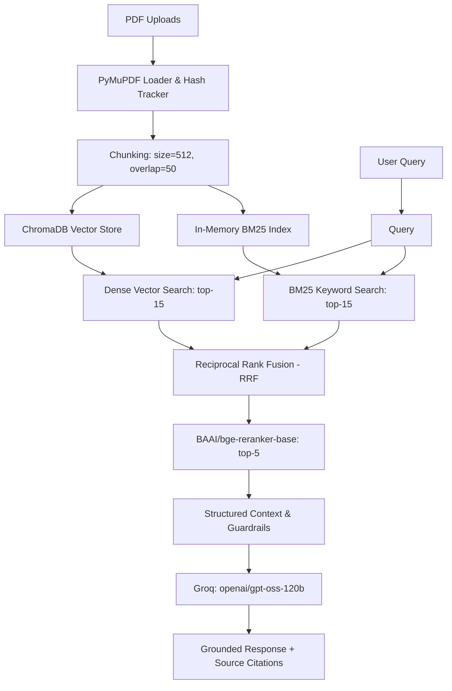

# Multi-Document RAG PDF Chatbot

[](https://streamlit.io/)
[](https://www.llamaindex.ai/)
[](https://console.groq.com/)
[](https://www.trychroma.com/)
[](file:///tests)

A hardened Retrieval-Augmented Generation (RAG) web application built with **Streamlit**, **LlamaIndex**, and **Groq** (`openai/gpt-oss-120b`) for grounded, multi-document question answering across PDF documents.

**[Live Application Demo](https://rag-pdf-chatbot-yh267qtmr7iibpctharmyb.streamlit.app)** 

---

## Key Features

- **Multi-Document Knowledge Base:** Upload and query across multiple PDF documents simultaneously in a unified vector collection.
- **Incremental Document Synchronization:** Hash-based change detection automatically synchronizes uploads, replaces modified documents, and removes deleted files without full re-indexing.
- **Advanced 4-Stage Retrieval Pipeline:**
  1. **Hybrid Search:** Combines dense semantic vector search (`sentence-transformers/all-MiniLM-L6-v2`) and sparse keyword search (BM25).
  2. **Reciprocal Rank Fusion (RRF):** Merges and normalizes candidate chunks across dense and sparse retrievers.
  3. **Cross-Encoder Joint Reranking:** Re-scores query-chunk pairs jointly with `BAAI/bge-reranker-base` down to the top-5 most relevant chunks.
  4. **Strict Grounding & Fallback:** System prompt enforces factual synthesis exclusively from retrieved context, returning standard fallback (`"I could not find that information across the uploaded documents."`) when context is insufficient.
- **Architecture-Aware Grounding:** Explicitly distinguishes actual application runtime architecture from concepts merely taught or discussed in uploaded documents (e.g., preventing false claims about ReAct agents or LangGraph).
- **Rigorous Evaluation Harness:** Structured LLM-as-a-Judge validation with boolean verdicts, bounded retries, abstention verification, and automated JSON reporting.
- **Comprehensive Regression Tests:** 28 automated unit tests covering document management, prompt constraints, and evaluation logic.
- **Conversation-Aware Follow-ups:** A bounded recent chat window is included in retrieval queries so questions such as “what about the second one?” retain context.
- **Secure Upload Handling:** Filename sanitization, PDF signature checks, configurable size/page limits, and escaped citation rendering.
- **Page-Level Citations:** Retrieved sources show the originating document and page number when available.
- **Operational Resilience:** Structured latency/source-count logs, explicit user-facing failures, and a smaller Groq fallback model.
- **Streaming Answers:** The UI streams generated tokens while preserving source citations.
- **Optional Workspaces:** Set `APP_PASSWORD` to enable password-protected named workspaces, each with isolated data and ChromaDB directories.
- **CI Quality Gate:** GitHub Actions compiles the application and runs the complete test suite for every push and pull request.

---

## Architecture



---

## Tech Stack

| Layer | Component | Technology |
| :--- | :--- | :--- |
| **Frontend UI** | Web Interface | Streamlit |
| **Orchestration** | RAG Framework | LlamaIndex |
| **Generation LLM** | Remote Inference | Groq API (`openai/gpt-oss-120b`) |
| **Judge LLM** | Evaluation Judge | Groq API (`openai/gpt-oss-120b`) |
| **Embedding Model** | Dense Representation | HuggingFace (`sentence-transformers/all-MiniLM-L6-v2`, 384-dim) |
| **Vector Store** | Persistent Database | ChromaDB |
| **Keyword Index** | Sparse Search | BM25 (`llama-index-retrievers-bm25`) |
| **Rank Fusion** | Hybrid Fusion | Reciprocal Rank Fusion (`QueryFusionRetriever`) |
| **Reranker** | Cross-Encoder | `BAAI/bge-reranker-base` |
| **PDF Extraction** | Document Ingestion | PyMuPDF (`fitz`) via LlamaIndex |
| **Configuration** | Environment | `python-dotenv` |
| **Test Suite** | Unit & Regression Tests | `pytest` |

---

## Run Locally

### 1. Clone the repository

```bash
git clone https://github.com/Ayushcv-46/rag-pdf-chatbot.git
cd rag-pdf-chatbot
```

### 2. Create and activate a virtual environment

**Windows PowerShell:**
```powershell
python -m venv venv
.\venv\Scripts\Activate.ps1
```

**macOS / Linux:**
```bash
python -m venv venv
source venv/bin/activate
```

### 3. Install dependencies

```bash
python -m pip install --upgrade pip
pip install -r requirements.txt
```

### 4. Configure environment variables

Create a `.env` file in the root directory:

```env
GROQ_API_KEY=your_groq_api_key_here
```

> [!NOTE]
> Obtain an API key from [Groq Console](https://console.groq.com/). Never commit `.env` or expose API keys in public repositories. If a key is exposed, revoke it and create a replacement immediately.

### 5. Start the application

```bash
streamlit run app.py
```

Upload PDF files via the sidebar to start asking questions across your documents.

---

## Automated Tests

Run the full unit test suite from the repository root:

```bash
python -m pytest tests/ -v
```

**Latest Verified Test Run:** `30 passed`

### Test Coverage Highlights:
- **`test_document_manager.py`**: Empty knowledge base handling, incremental document additions, hash-based modification replacement, clean removal of chunk embeddings from ChromaDB, and invalid PDF handling.
- **`test_architecture_grounding.py`**: Verified runtime architecture facts, query detection for architecture vs document questions, anti-extrapolation constraints (preventing hallucinated benchmarks), and document-scoped fallback behavior.
- **`test_evaluation.py`**: Fallback detection, structured JSON verdict parsing, bounded retries on conversational responses, unreasoned initial feedback fallthrough, and abstention justification checks.

---

## Evaluation Framework & Findings

The project includes an evaluation suite (`eval.py` and `eval_utils.py`) to systematically diagnose retrieval and generation quality using an LLM-as-a-Judge.

Run the evaluation harness:
```bash
python eval.py
```

### Benchmark Summary Across Project Phases

| Metric | Phase 2 Baseline | Phase 3 (Grounding Fixes) | Focus / Resolution |
| :--- | :---: | :---: | :--- |
| **Test Questions** | 10 | 10 | Paraphrased, Day-specific, and Architecture queries |
| **Abstention Accuracy** | 50.0% | **100.0%** | Eliminated unjustified abstentions (Q5 Day 14 notes resolved) |
| **Answer Relevancy** | 90.0% | **90.0%** | Consistent contextual relevance |
| **Grounded Faithfulness** | 60.0% | **87.5%** | Prohibited latency/benchmark extrapolation (Q2 resolved) |
| **Evaluation Reliability** | Conversational judge | **Structured JSON + Retries** | Bounded retries prevent raw text failure classification |

### Benchmark Evaluation Categories (10 Canonical Queries):
- **Category A (Paraphrased & Abstract):** Debugging retrieval (`response.source_nodes`), fast vs accurate search tradeoffs, chat memory mechanism.
- **Category B (Fact-Specific Lookups):** Specific topic lookups across study notes (Day 9 vector index, Day 14 function refactoring, Day 17 error handling, Day 25 RAG evaluation).
- **Category C (System & Architecture):** Anti-hallucination workflow, handling out-of-document queries, multi-document unified search mechanism.

*All evaluation traces and diagnostic outputs are saved under `evaluation_results/`.*

## Configuration

The application reads configuration from environment variables or `.env`:

```env
GROQ_API_KEY=your_groq_api_key_here
GROQ_MODEL=openai/gpt-oss-120b
GROQ_FALLBACK_MODEL=openai/gpt-oss-20b
APP_PASSWORD=optional_shared_workspace_password
MAX_UPLOAD_BYTES=26214400
MAX_PDF_PAGES=250
MAX_CONTEXT_MESSAGES=6
```

`MAX_UPLOAD_BYTES` defaults to 25 MiB. `MAX_PDF_PAGES` defaults to 250. The API key is never logged or stored in source code.

When `APP_PASSWORD` is configured, users must provide the workspace name and password. Workspace names are hashed into isolated storage paths and are never used directly as filesystem paths. For internet-facing multi-user deployments, replace this lightweight mode with an identity provider and session-backed authorization.

If the interface reports that the language-model provider could not complete a request, first verify that `GROQ_API_KEY` is a newly generated, active key and restart Streamlit. The server log will contain the provider status code and request error without printing the key. A 401/403 indicates credentials, while a 404 indicates an unavailable model name.

## Security and reliability

- Uploaded names are flattened and sanitized before they are used as filesystem paths.
- Files must have a PDF signature and pass PyMuPDF validation before indexing.
- Citation filenames and extracted text are HTML-escaped before custom HTML rendering.
- Retrieved context is sent to Groq for generation; embeddings and the local ChromaDB remain on disk.
- Network calls use bounded timeouts and retries. If the primary Groq model fails, the request retries once with `openai/gpt-oss-20b`.
- Responses are streamed in the UI when the provider supports streaming.
- Errors are logged with stack traces server-side while users receive actionable, non-sensitive messages.
- The optional workspace password provides basic isolation for controlled deployments; it is not a replacement for OAuth/OIDC, database-backed sessions, or enterprise identity management.

## Production roadmap

For a full production deployment, add authentication, per-user Chroma collections, encrypted storage, rate limiting, a background indexing queue, retention policies, and external metrics/tracing. These controls are deployment concerns and are intentionally not simulated inside the single-user Streamlit app.

---

## Project Structure

```text
rag-pdf-chatbot/
├── app.py                  # Streamlit application UI and chat loop
├── core_rag.py             # RAGIndexManager, hybrid retrieval pipeline, settings
├── eval.py                 # Evaluation benchmark script and reporter
├── eval_utils.py           # Structured judge prompts, parser, and metrics
├── tests/
│   ├── test_architecture_grounding.py
│   ├── test_document_manager.py
│   └── test_evaluation.py
├── data/                   # Input PDFs directory (ignored by git)
├── chroma_db/              # Persistent ChromaDB vector store (ignored by git)
├── evaluation_results/     # Timestamped evaluation reports (JSON)
├── .github/workflows/ci.yml # Automated compile and test checks
├── .env                     # Groq API key (ignored by git)                    # Groq API key (ignored by git)
├── .gitignore              # Environment and database ignore rules
└── requirements.txt        # Pinned Python package dependencies
```

---

## Security & Best Practices

- **Zero Credential Exposure:** `.env` and virtual environments (`.venv/`, `venv/`) are excluded via `.gitignore`. Use `GROQ_API_KEY`; never place a key in source code.
- **Fail-Fast Client Timeouts:** Configured 30.0s HTTP client timeout with bounded retries to prevent dead socket hangs.
- **Data Protection:** Chunks and vector embeddings are stored locally in `./chroma_db`; retrieved context is sent to Groq for answer generation.

---

## Author

**Ayush CV** — B.Tech, Computer Science & Information Technology  
GitHub: [@Ayushcv-46](https://github.com/Ayushcv-46)
